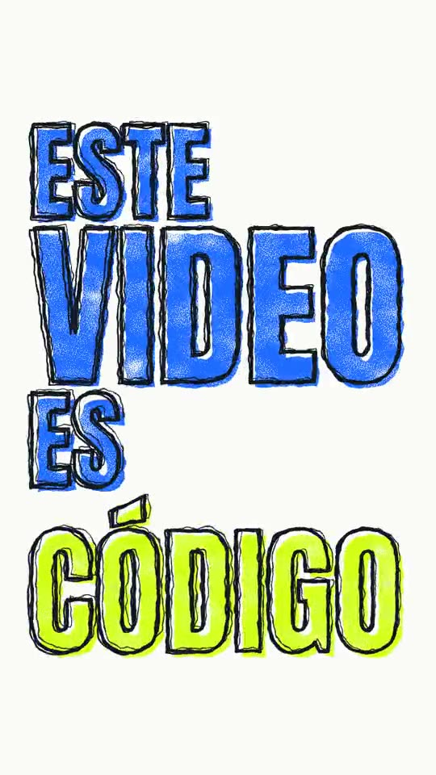
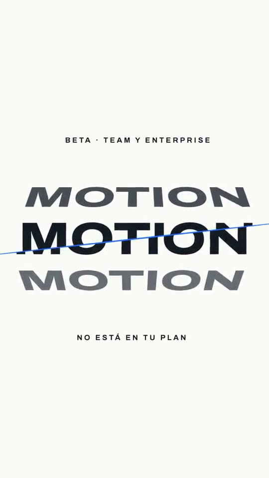
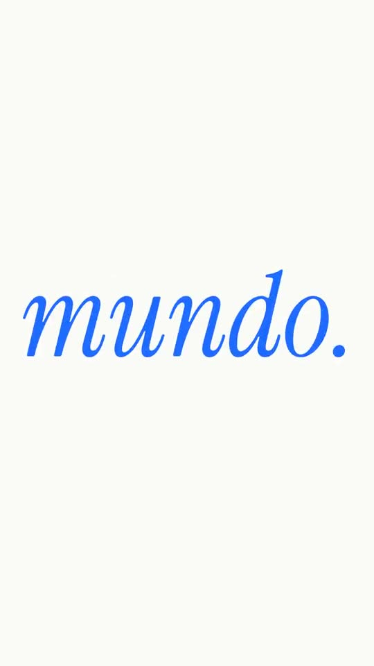
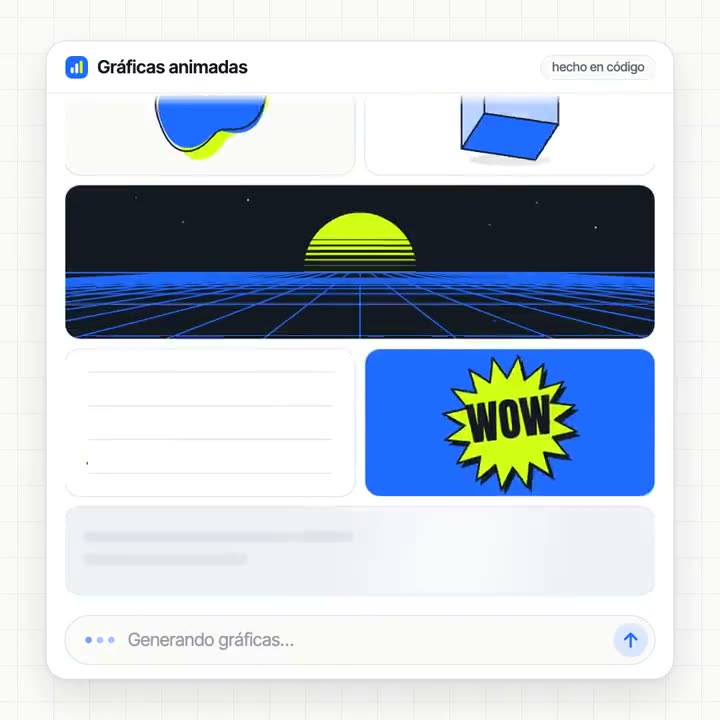

# Motion con código

Títulos y gráficas animadas para tus videos, hechos por tu agente escribiendo código. Sin After Effects, sin keyframes y sin abrir un editor.

Así se animó mi video: Claude escribió cada título en código y sacó el video en mi computador.

| | | | |
|---|---|---|---|
|  |  |  |  |

Los videos están en [`examples/`](examples/).

## Cómo se usa

Abre la app de escritorio de tu agente, en el modo que trabaja en tu computador, y pégale esto:

```text
Ayúdame a crear mi primer título animado en código, con fondo transparente,
para ponerlo sobre mi video.
Lee https://github.com/lara-industries/motion-con-codigo/blob/main/START-HERE.md
Primero comprueba qué herramientas tengo y dime qué falta y cuánto ocupa.
Guíame paso a paso hasta ver mi primer video. Si esta sesión no puede crear
archivos en mi computador, dime cómo abrir una que sí pueda.
```

El resto lo explica [START-HERE.md](START-HERE.md), para ti y para tu agente.

## Qué hay aquí

- [`START-HERE.md`](START-HERE.md): el recorrido hasta tu primer video.
- [`prompts/`](prompts/): los cuatro prompts, listos para pegar.
- [`plantilla/`](plantilla/): un proyecto que ya funciona, con el título de serigrafía.
- [`skills/motion-con-codigo/`](skills/motion-con-codigo/SKILL.md): la skill para que tu agente lo repita cuando quieras.
- [`examples/`](examples/): lo que salió de cada prompt.

## De dónde viene

La idea y los cuatro prompts originales son de [Roberto Nickson](https://rpn.beehiiv.com/p/claude-just-became-your-motion-designer). Aquí están en español, adaptados y ejecutados. La historia completa, con lo que funcionó y lo que no, está en [mi guía](https://sebastianlara.io/guias/motion-con-claude/).

Probado en macOS con Claude Code. En otros agentes y sistemas todavía no.

Sebastián Lara · [sebastianlara.io](https://sebastianlara.io)
